# Przegląd aplikacji SARnik v2 (14 listopada 2026)

Zakres: kod, teksty, zachowanie w przeglądarce, ładowanie i to, co widzi juror. Nauka o radarze i potok danych są w osobnym przeglądzie (`docs/przeglad-v2/NAUKA.md`, inny komputer).

Stan kodu: `main` = `0cdedf1` (po scaleniu v3). Poprawki opisane niżej są w drzewie roboczym tego komputera i czekają na PR. Nic nie zostało scalone ani wdrożone. Numery linii `app.js` podane w uwagach dotyczą `main`. Po poprawkach przesunęły się o ok. 3–12 linii.

Liczby: 71 potwierdzonych uwag (2 blokery, 29 ważnych, 40 drobnych). 0 odrzuconych. 0 niezweryfikowanych.

## W skrócie

- Aplikacja działa: karta miejsca, oś czasu radaru, rysowanie obszaru, PL/EN, tryb ciemny i link do miejsca przechodzą testy. 14 poprawek (w tym bloker A14) czeka na PR.
- Najpierw: wdrożyć `main` na adres publiczny (A41, bloker). Pod tym adresem jest dziś v1 bez radaru. Przy okazji dodać `no-cache` dla „/” w `firebase.json` (A42). Robi to tylko właściciel projektu Firebase.
- Potem: scalić PR z poprawkami i podbić `?v=` w `index.html` (dziś `1794680600`), żeby przeglądarki nie łączyły nowego `app.js` ze starymi tekstami.
- Trzecie: pokazać jurorowi NISAR wprost: legenda NISAR myli zabudowę z lasem (A55), karta miejsca nie ma wiersza NISAR (A62), objaśnienie polaryzacji jest tylko pod ikoną (A63).

## Do poprawy przed zgłoszeniem

Blokery i uwagi ważne. Duplikaty są połączone w jeden wiersz. „Poprawione w PR” znaczy: zmiana jest w drzewie roboczym i przeszła testy, ale nie jest jeszcze scalona.

| id | plik i miejsce | problem | dowód | poprawka | status |
|---|---|---|---|---|---|
| **A14** / A58 (bloker) | `web/i18n_sar.js` `plain.nextHigh` (l.319 PL, l.364 EN); `app.js` `plainChecks` l.1606, `riskOf` l.1382 | Przy szansie 5–15% karta pisze, że wolny teren obok „najpewniej zostanie zabudowany” / „is likely to be built on”. Zdanie przeczy samo sobie i wprowadza kupującego w błąd. | Karta PL, Swarzędz: „Wolny teren obok najpewniej zostanie zabudowany: ok. 5% szans w 5 lat…”. Karta EN, Plac Wolności: „…is likely to be built on: about 13% chance in 5 years”. | Tekst opisuje pozycję: „jedna z najwyższych szans zabudowy wokół Poznania: ok. p% w ciągu 5 lat”. `nextMid` PL: „w ciągu 5 lat”. | poprawione w PR |
| **A41** (bloker) | `README.md` l.15; kanał live w Firebase | Adres publiczny podaje wersję 1 bez radaru. Juror zobaczy stary produkt. | `curl https://poznan-trend-detective.web.app/` → `<title>Poznań Trend Detective</title>`, `app.js?v=1794665275`; `…/data/land/sar.json` → 404. Podgląd v2 i v3: tytuł SARnik, `sar.json` 200. | Właściciel Firebase wdraża `main` na live przed 15.11 23:59. Potem oba `curl` jeszcze raz (tytuł SARnik, 200). | do decyzji autora (tylko właściciel Firebase) |
| A1 / A56 | `web/app.js` `onHover`, gałąź ekspercka l.1077-1086 | Dymek eksperta nazywa typ terenu progami pasma C (> −6,5 dB = zabudowa) także dla pasma L (ALOS-2, NISAR). Las w widoku startowym NISAR 2026 to „Built-up”. | Przeglądarka, PL, ekspert, 2026: Puszcza Zielonka (52.5349,17.1320) → „HH/HV: Built-up (-3,8 dB)”. Siatka: `nisar_hh_med` nazywa 90% komórek leśnych zabudową (mediana −4,67 dB); `alos_hh_2021`: 52% lasu „built”, 84% terenu otwartego „water”. | Dla HH/HV tylko wartość dB, bez słowa o typie. Słowa pasma C zostają dla VV/VH. | poprawione w PR (las: „HH/HV: -4,3 dB”) |
| A2 / A20 / A30 / A57 | `web/app.js` `onHover` l.1082-1109 | 12 testów `state.lang === "pl"`. Obiekt `state` nie ma `lang` (język jest w `let lang`, l.22). Polska strona pokazuje angielskie słowa w dymku eksperta. | `grep -c 'state.lang' app.js` → 12. PL, ekspert: „Poznań / HH/HV: Built-up (-1,7 dB)”, „Radar 2026: zmiana: Stable (−0,1 dB)”. | `state.lang` → `lang` w 12 miejscach, razem z A1. | poprawione w PR |
| A3 / A44 | `web/app.js` `finishSelection` l.1344-1352 | Gdy jedna z 37 warstw PNG miejsca się nie wczyta, karta na zawsze zostaje na „Liczę dane dla tego miejsca…”. Błąd idzie tylko do konsoli. | l.1346: `try { await Promise.all(PLACE_LAYERS().map(loadGray)); } catch (e) { console.error(e); return; }`. `sar_series.png` → 503: po 8 s karta „Stary Rynek 1, Poznań / Liczę dane…”. `sar_change.png` przerwany: po 12 s to samo. | Karta błędu po polsku i angielsku z przyciskiem „Spróbuj ponownie”, który woła `finishSelection(sel)`. Trzeba też `renderCardLoading`, bo `selectPoint` nadpisywał kartę błędu. | poprawione w PR (bez `Promise.allSettled`) |
| A4 | `web/app.js` `initMap`, `wuiaLayer` l.495-507 (`pane: "land"`) | Kanwa panelu nakładek leży nad wielokątami decyzji budowlanych. Dymek decyzji nigdy się nie otwiera, a klik wybiera punkt. | Klik w wielokąt „nowa budowa” (52.38365,16.99994): `elementFromPoint` = CANVAS w `leaflet-overlay-pane`, dymek brak, hash `#52.38364,16.99995`. Z `bubblingMouseEvents: false` zamiast `pane: "land"`: dymek „rozbudowa / Ustalenie warunków zabudowy…”. | `bubblingMouseEvents: false` (sprawdzone). Uwaga: wtedy klik w wielokąt podczas rysowania obszaru otwiera dymek zamiast dodać róg. Trzeba np. ignorować dymki, gdy `draw.mode` jest ustawione. | do decyzji autora (lub właściciela warstwy) |
| A5 | `web/app.js` `wireDrawer`, `[data-toggle]` l.1006-1017 | Włączenie dowolnej warstwy w szufladzie (np. decyzji) zeruje `state.lens`. Oś czasu skacze na 1975–2035 i „2020 dane z pomiarów”, a mapa i legenda dalej pokazują NISAR 2026. | l.1011-1012 `state.lens = match ? match.k : null`. Przeglądarka: po `#sw-wuia` brak wciśniętego widoku, `#tl-year` „2020”, legenda „Tak radar NISAR widzi okolicę (2026)”. | Warstwy wuia, flood i nisar nie decydują o widoku. | poprawione w PR. Zostaje: `applyLens` wyłącza wuia przy zmianie roku radaru (do decyzji autora). |
| A6 | `web/app.js` `wireDrawer`, suwak `aly` l.1029 | Suwak roku ALOS-2 zmienia mapę i legendę, ale nie oś czasu. | Ekspert, widok radaru, `aly` = 1: legenda „Radar ALOS-2, pasmo L, 2016”, oś „2026 / radar NISAR”. | W widokach radaru ustawić `state.ryear` i wywołać `renderTimeline()` (bez `setRYear`, żeby nie przebudować szuflady w trakcie przeciągania). | poprawione w PR. Skutek uboczny do potwierdzenia: po użyciu suwaka widoki Nowe budowy, Woda i Grunt pokazują archiwum ALOS-2 z tego roku (zgodnie z `lensLayers`). Przypadek brzegowy: suwak na 2026 w tych widokach. |
| A31 / A60 | `web/app.js` `wire()`, `#year` input/change l.2025-2029; `renderTimeline` l.736; `setRYear` l.898-907 | Klawiaturą nie da się przejść przez lukę 2021–2026. Zdarzenie `change` drugi raz woła `setRYear` i cofa ruch. Klik w lukę ląduje raz na 2021, raz na 2026. | Fokus na `#year` przy 2026, 3× ArrowLeft → „2026” za każdym razem (zdarzenia `input:2025`, `change:2026`). Od 2015 ArrowRight zatrzymuje się na 2021. Punkt 12 `poprawa_mapy.md` wymaga tego testu. | W `change`, gdy `radarTL()`: tylko `e.target.value = state.ryear`. | poprawione w PR (Left, Left, Right, Right, Home, End → 2021, 2020, 2021, 2026, 2015, 2026) |
| A59 | `web/app.js` `renderTimeline` l.763; `setLens` l.893 | Widok Drzewa pokazuje zmierzoną wycinkę 2001–2024, a oś pisze „prognoza modelu” i ma fioletowe tło prognozy. `isFuture()` to logika zabudowy (rok > 2020). | Widok Drzewa: `#tl-year` „2024”, `#tl-kind` „prognoza modelu”, klasa `future`; legenda „Wycinka lasów (rok) 2001–2024”. | W widoku Drzewa lata do 2024 to pomiary. | poprawione w PR |
| A15 | `web/i18n_sar.js` `plain.buildNo` (l.316, l.361); `app.js` `plainChecks` l.1601-1602 | Karta twierdzi „W ostatnim roku nic nowego tu nie wyrosło”, choć reguła dopuszcza do 2% koła 1 km z nowymi ścianami, a komórki 120 m nie widzą pojedynczych domów (README l.84). | Kod l.1601 wybiera `buildNo`, gdy `s.walls <= 0.02` i `s.up <= 0.05`. README: „our 120 m cells show estates and streets, not single houses”. | „Radar nie widzi tu w ostatnim roku większych nowych budów. Pojedynczy dom jest dla niego za mały.” i odpowiednik EN. | poprawione w PR |
| A16 | `web/i18n_sar.js` `fp.radar` / `fe.radar` l.444-447; `hov.walls`, `lensTip.build`, `lgPlain.wallsNow` | Ustalenie na starcie „Gdzie w tym roku stanęły nowe budynki… 4,5 razy częstsze na działkach z pozwoleniem”. 4,5× dotyczy każdego pojaśnienia o 3 dB. Dla nowych ścian stosunek to 1,63, p = 0,28 (nieistotny). | `sar.json` `checks.wuia`: ratio 4,46 (12 z 766 komórek); `checks.wuia_walls`: ratio 1,63, p 0,2811. Arkusz radaru sam mówi, że „nowe ściany” nad Wartą to często odsłonięty brzeg. | Tytuł „Gdzie radar widzi nowe ściany”, uwaga o brzegach, 4,5× opisane jako pojaśnienie terenu na działkach z decyzją. Te same zmiany w `hov.walls`, `lensTip.build`, `lgPlain.wallsNow`. | poprawione w PR |
| A19 / A65 | `web/i18n.js` `aboutHtml` (l.87-112, l.199-224); `i18n_sar.js` `aboutSar` l.227-246; kolejność w `app.js` `applyLang` l.2006 | „O projekcie” to tekst v1: wstęp o testach trendu, „GEOPOZ Poznań (2025, 1940)” zamiast 2001, „Podkład: Esri” zamiast OpenFreeMap, brak ograniczeń radaru z README. Sekcja radaru stoi na końcu, po AI, pod nagłówkiem „Radar (SARnik v2)”. | `app.js` l.475 `ortogpkg:ortofotomapa_2001`. EN About: 4 ograniczenia v1, żadne o radarze lub NISAR. README l.82-93 „Limits we state openly”. | 1940 → 2001, „OpenFreeMap / OpenStreetMap (Esri jako zapas)”, wstęp o przeglądzie radarowym, nowy nagłówek i lista „Ograniczenia radaru” z README. | częściowo: teksty poprawione w PR. Kolejność sekcji (w `applyLang`) do decyzji autora. |
| A21 | `web/i18n_sar.js` `plain.heatT`, `heatFast`, `heatOk` (l.346-349, l.391-394) | Wiersz „Upał latem” / „Summers here are warming” opisuje temperaturę powierzchni MODIS (dachy i grunt), a nie powietrze. Sama aplikacja pisze w ograniczeniach, że to nie powietrze. Zdanie EN niegramatyczne („faster than around”). | `plainChecks` l.1622 `testSeries(heatSeries("day", sel.sq))`; `i18n.js` l.109 „Surface temperature is roofs and ground, not air.” | „Nagrzewanie powierzchni latem” / „Summer surface heat” i zdanie o dachach i gruncie. | poprawione w PR |
| A42 | `poznan-trend-detective/firebase.json`, reguła `**/*.html` przy `cleanUrls: true` | Strona „/” ma `max-age=3600`. Kto otworzył stronę godzinę przed wdrożeniem, do godziny widzi starą wersję. | `curl -sI https://poznan-trend-detective.web.app/` → `cache-control: max-age=3600`; `…/index.html` → 301 na `/`. | Reguła nagłówka dla korzenia, np. `"regex": "^/(index\\.html)?$"` z `Cache-Control: no-cache`. Wdrożyć z v2 i sprawdzić `curl -sI /`. | do decyzji autora (plik poza zakresem; wdraża właściciel Firebase) |
| A43 | `web/app.js` `finishSelection` l.1344-1351, `PLACE_LAYERS` l.1278, `main` l.2069, pobranie wuia l.495 | Karta czeka na 37 PNG (10,48 MB) dla całego obszaru. Start ładuje też `wuia_decyzje.geojson` (2,65 MB), choć warstwa jest wyłączona. | Podgląd v3, 390 px, 1,6 Mbps: pierwsza karta 26,33 s, karta miejsca 38,1 s po stuknięciu. Lokalnie 9 Mbps: 11,0 s i 10,8 s. Przy 4× CPU karta 0,2 s, więc wąskim gardłem jest pobieranie. | Przed zamrożeniem: wuia ładować dopiero po włączeniu, warstwy `SAR_PLACE()` jako pierwsze, licznik postępu w karcie ładowania. | do decyzji autora |
| A45 | `web/app.js` `main` l.2049-2073; `index.html` l.47 | Do przyjścia wszystkich danych strona jest pusta: pusta karta, pole szukania bez podpowiedzi, brak widoków, oś „2020”. Brak znaku ładowania. | `sar.json` opóźniony 8 s, po 3 s: tekst karty 0 znaków, placeholder pusty, 0 przycisków widoków. | Statyczna linia „Wczytuję dane… · Loading data…” w `#sidecard` i podpowiedź w `#q`. | poprawione w PR |
| A46 | `web/app.js` `makeVectorBase` l.412, `initMap` l.465, `main` l.2060 | Start czeka na styl OpenFreeMap bez limitu czasu. Wolny serwer blokuje całą aplikację. Zapas Esri działa tylko przy błędzie. | Styl opóźniony 25 s: po 10 s 0 widoków i pusta karta, gotowe po 27,1 s. Styl przerwany: Esri, gotowe w 2,9 s. | Wyścig z limitem 4 s, potem zapas Esri. Nieudany wynik nie trafia do pamięci podręcznej. | poprawione w PR (styl opóźniony 25 s: gotowe w 5,7 s) |
| A47 | `web/app.js` `redraw` l.707-710 | Przy włączonej warstwie NISAR GCOV (GIBS) każde `redraw()` (suwak, inna warstwa, klatka odtwarzania) pobiera wszystkie kafle od nowa. GIBS wysyła `no-store`. | `curl -D -` kafla GIBS → `cache-control: max-age=0, no-store, no-cache`. Pomiar: 5 ruchów suwaka → 28 nowych kafli; 3 s odtwarzania → 141 żądań; 14,2 MB GIBS w sesji. | Zapamiętać ostatni URL, `setUrl` tylko przy zmianie, usunąć `else redraw()`. | poprawione w PR (niezmierzone w przeglądarce, GIBS był zablokowany) |
| A48 | `web/app.js` `geocode` l.1942-1945, `initSearch` l.1980-1986, `renderSuggest` l.1969 | Gdy Nominatim nie działa, zwraca 429 albo nic nie znajduje, wyszukiwarka nic nie mówi. Enter nic nie robi. | l.1944 `return r.ok ? r.json() : [];`. Nominatim przerwany, wpisane „Półwiejska 2”: lista ukryta, brak komunikatu, Enter bez skutku. | Odróżnić „brak wyników” od „usługa niedostępna”. Jeden niewybieralny wiersz z tekstem PL/EN i wskazówką „kliknij mapę”. | do decyzji autora |
| A55 (też A13, A33) | `web/app.js` `RGB_STRETCH.nisar`, `RADAR_LEGEND.nisar` l.548-560, `renderLegend` l.824 | Widok startowy NISAR 2026: zabudowa i las mają w legendzie dwa bliskie zielone, a na mapie centrum Poznania ma ten sam limonkowy kolor co Puszcza Zielonka. Juror czyta „miasto to las”. | Legenda: zabudowa rgb(132,203,94), las rgb(129,225,39) (ΔE ok. 30). Mediana koloru na mapie: zabudowa 151,221,89, las 129,226,39. Przyczyna w danych: `sar.json` `nisar.checks.bands` zabudowa HH −4,49 / HV −11,13, las HH −4,67 / HV −10,16. ALOS-2 tak samo. | Krótko: w legendzie NISAR i ALOS jeden uczciwy wiersz „zabudowa lub las (pasmo L widzi oba jasno)”. Rozciągnięcie kanału B tylko po zgodzie recenzenta nauki. | do decyzji autora (z recenzentem nauki) |
| A62 | `web/app.js` `plainChecks` l.1596-1630, `renderCard` l.1503 (`details.tech`) | Grupa „Z radaru SAR” na prostej karcie pokazuje Sentinel-1 i EGMS. NISAR jest tylko w źródle wiersza o wodzie albo wcale. Liczby NISAR są tylko w zwiniętych szczegółach. | Karta EN, Plac Wolności: brak słowa NISAR na prostej karcie. W `details.tech`: „NISAR: wet minus dry +0.9 dB HH, 25 Jun → 24 Aug…”. Dopiewo (53% nasiąka) ma wiersz NISAR. | Zawsze jeden prosty wiersz NISAR w grupie SAR. Tekst w `i18n_sar.js` `plain`. | do decyzji autora |
| A63 | `web/index.html` `#radar-btn` l.52-54; `app.js` `renderFindings` l.1847 | Objaśnienie polaryzacji (czego wymaga wyzwanie) otwiera tylko ikona bez napisu albo link w zwiniętym bloku technicznym. | `#radar-btn` innerText „”. Karta startowa nie ma elementu `[data-radar-how]`; jedyny jest w `radarBlock` l.1483 wewnątrz `details.tech`. | Widoczny link tekstowy `<button class="linkish" data-radar-how>` we wstępie ustaleń i w nagłówku „Z radaru SAR”. Obsługa kliknięcia już istnieje (l.2044). | do decyzji autora |

## Drobiazgi

Potwierdzone uwagi drobne. Duplikaty połączone.

- **A7** `app.js` `onHover` l.1077-1079: warunek sprawdza `ready("s1rgb")`, ale następna linia czyta `L8.sar_vv_med`, gdy tylko `s1rgb.on`. Przy niezaładowanej warstwie każdy ruch myszy rzuca TypeError (6 błędów na 3 ruchy). Poprawka: `const useS1 = Ly.s1rgb.on && ready("s1rgb")`. Otwarte.
- **A8** `app.js` `onHover` l.1088-1093, l.1104-1110: dymek eksperta ma własne progi (±3 dB bez testu ścian, ±3 mm/rok), inne niż mapa i legenda. 651 komórek „jaśniej, bez ścian” nazywa „New building / wall”; 3678 komórek EGMS z 2 ≤ |v| < 3 mm/rok nazywa stabilnymi. Poprawka: progi i test ścian z gałęzi prostej, słowa z `u.hov`. Otwarte.
- **A9 / A34** `app.js` `renderLegend` l.824-856: warstwa decyzji budowlanych nie ma legendy. Kolory #E5602A, #7357E8, #F2A31B nie są nigdzie objaśnione. Test e2e 4 pada na tym 4 razy. Poprawka: blok legendy z trzema próbkami i tekstami PL/EN. Otwarte.
- **A10** `app.js` `wire()` l.2045: gdy system przełącza się na ciemny motyw, interfejs ciemnieje, a mapa bazowa zostaje jasna (#F1F0EB). Poprawka: wydzielić `refreshTheme()` z `setTheme` i wołać ją w słuchaczu. Otwarte.
- **A11 / A32** `app.js` `renderTimeline` l.733-748, l.2031-2037: punkt 1 `poprawa_mapy.md` jest odhaczony, ale na osi radaru (start i 4 z 6 widoków) nie ma przycisku „Dziś”, napisu „najnowszy przelot” ani stanu „dziś” w linku. Poprawka: odznaczyć lub rozdzielić punkt 1 w `poprawa_mapy.md`, albo dodać przycisk (właściciel punktu 1). Otwarte.
- **A12 / A39 / A51** `app.js` `main().catch` l.2074-2077: gdy jeden z sześciu plików startowych zawiedzie, polska strona pokazuje angielski komunikat dla programisty („Serve the web folder over HTTP…”) i nie ma widoków. Poprawka: tekst wg `lang`, przycisk przeładowania, wskazówkę o serwerze tylko przy `file:`; `podtopienia.geojson` z zapasem pustej kolekcji. Otwarte.
- **A13 / A33**: to ta sama sprawa co A55 (tabela wyżej). Próbki nie są identyczne (ΔE ok. 30–35), ale legenda nie oddziela zabudowy od lasu.
- **A17** `i18n_sar.js` `fp.ground` / `fe.ground`: ustalenie o osiadaniu nie podaje, że EGMS mierzy 24% obszaru i dane są z 2016–2020. Poprawione w PR.
- **A18 / A61** `i18n.js` EN `aboutHtml` l.111-112: „Use of SI tools”, „an SI assistant”. Poprawione w PR („AI”).
- **A22** `i18n_sar.js`, `i18n.js`: zła odmiana liczebników po polsku („2 komórek”, „23 przelotów”, „1 komórek”). Poprawione w PR (pomocnik `plForm`, `i18n_parity --strict`: 0 ostrzeżeń).
- **A23** `i18n.js` `pl.L`: brak `L.wuia`. Poprawione w PR.
- **A24** angielska gramatyka (`treesCut`, `lensTip.trees`, `lensTip.history`, `priceV`, `f.sprawl`). Poprawione w PR.
- **A25** `plain.priceV`: „średnio”, a GUS P3787 to mediana. Poprawione w PR („typowo (mediana GUS)”).
- **A26** `plain.treesOk`: na polach bez drzew karta pisze „drzewa w większości stoją (ubyło ok. 0,0 ha)”. Poprawione w PR (sam tekst).
- **A27** PL `radarHtml`: „Mieszkańcy dostaną ostrzeżenie…” obiecuje usługę, której nie ma. Poprawione w PR.
- **A28** `hov.dries`, `lgPlain.drier`, `lg.drier`: „po deszczu ziemia przesycha (żniwa)” przeczy samo sobie. Poprawione w PR („ciemniej niż w czerwcu: raczej żniwa”).
- **A29 / A36 / A66** `index.html` l.6, l.8, l.21, l.77; `app.js` `applyLang`: nazwa SARnik jest tylko w tytule karty przeglądarki, a ten zostaje polski na stronie EN. `aria-label` „Map” i „Language” są angielskie na stronie PL. `appName` nie jest używane. Test e2e 1 pada 4 razy. Poprawka: `u.appName` w nagłówku, `document.title` w `applyLang`. Otwarte.
- **A35 / A64** `styles.css` l.353: na telefonie legenda ma `display: none`, karta startowa jest zwinięta do tytułu. Pierwszy ekran to niewyjaśniona mapa w fałszywych kolorach. Należy do punktu 10 `poprawa_mapy.md` (ma właściciela). Otwarte.
- **A37** `styles.css` l.158: przy otwartej szufladzie na laptopie widoki Drzewa i Historia są zasłonięte (przez szufladę, nie przez przyciski w prawym górnym rogu). Poprawione w PR: pasek widoków znika przy otwartej szufladzie, która ma te same widoki (zrzut 04).
- **A38** `app.js` `onHover` l.1067-1075: w trybie prostym widok startowy Radar nie ma żadnego dymka. Poprawka: dodać obsługę warstw alos i s1rgb (z klasą świadomą pasma L). Otwarte.
- **A40** `app.js` `initMap` l.512-525: część telefoniczna punktu 2 `poprawa_mapy.md` (wartość po stuknięciu, znika po 4 s) nie istnieje. Stuknięcie otwiera kartę. Poprawka: zaimplementować albo odznaczyć tę część (zapytać właściciela punktu 2). Otwarte.
- **A49** `app.js` `main` l.2054: bez `sar.json` aplikacja po cichu wraca do układu v1, a wstęp dalej obiecuje radar. Poprawka: jednolinijkowy komunikat PL/EN, `sar.json` w sprawdzeniu po wdrożeniu. Otwarte.
- **A50** `app.js` `ensure` l.719-724, wuia l.495-509: gdy dane warstwy zawiodą, mapa jest pusta, a legenda lub przełącznik twierdzą, że warstwa jest włączona. Otwarte.
- **A52** `app.js` l.357, `index.html`: gdy CDN Leaflet zawiedzie, strona jest pusta i bez komunikatu (`L is not defined`). Poprawka: skrypt inline po tagach CDN z komunikatem PL/EN. Otwarte.
- **A53** `web/data/land/land.json`, `sar.json` (`pipeline/model_urban.py` l.246, `pipeline/build_sar.py` l.299): 7 warstw nie ma reguły dekodowania (`study`, `loss_cum_2005/2010/2015/2020`, `nisar_wetdry`, `nisar_series`). `nisar_series` czytany regułą `sar_series` dostałby VV/VH zamiast HH/HV. `data_contract.py` pada, więc CI jest czerwone. Poprawka: właściciel potoku dopisuje reguły. Otwarte.
- **A54** `web/data/land/treecover2000.png` i `web/data/nisar/*.jpg`: ok. 680 KB wdrażanych, ale nieużywanych plików. Poprawka po zamrożeniu: `hosting.ignore` albo przeniesienie. Otwarte.
- **A67** `i18n_sar.js` `radarHtml`: arkusz radaru mówi o 693 ha nowych budynków, ustalenie na starcie o 358 ha. Poprawione w PR (693 ha to całe pojaśnienie, 358 ha to ściany).
- **A68** `i18n.js` l.100/212, l.259/310; `app.js` l.435: podpisy źródeł się nie zgadzają. Częściowo poprawione w PR (rok 2001 i OpenFreeMap w „O projekcie”). Otwarte: podpis na mapie przy warstwach radaru i stopka szuflady bez JAXA, EGMS/Copernicus i PIG-PIB.
- **A69** `styles.css` l.10, l.65, l.477: kontrast `--ink-3` 2,64:1, brak widocznego fokusu w `#q`, suwaki bez nazwy dostępnej. Częściowo poprawione w PR (`.pl-src` na `--ink-2`, obrys `.search:focus-within`). Otwarte: `aria-label` na suwakach (w `app.js` `rangeHTML`).
- **A70** `styles.css`: na 390 px pasek widoków wychodzi poza ekran bez sygnału, podpis mapy wchodzi pod kartę o 6 px, podpowiedź wyszukiwarki jest ucięta, cele dotyku są małe (`#fold` 45×19 px). Otwarte (punkt 10).
- **A71** `README.md` l.45, l.61; nagłówki `app.js` l.1 i `styles.css` l.1: README opisuje zmianę „od czerwca” i decyzje „June–August”, a aplikacja jesień 2026 do jesieni 2025 i „Jun–Nov”. Nagłówki plików mają starą nazwę. Otwarte.

## Testy

### Jak uruchomić

Z katalogu głównego repozytorium. Python z Playwrightem: `poznan-trend-detective/.venv/bin/python`, przeglądarka: systemowy Chrome (`channel="chrome"`). Szczegóły: `poznan-trend-detective/tests/README.md`.

```sh
node --check poznan-trend-detective/web/app.js poznan-trend-detective/web/i18n.js poznan-trend-detective/web/i18n_sar.js
node poznan-trend-detective/tests/i18n_parity.mjs --strict
python3 poznan-trend-detective/tests/data_contract.py
node docs/planwyd/kontrakt/selftest.mjs
poznan-trend-detective/.venv/bin/python poznan-trend-detective/tests/e2e_sarnik.py --serve poznan-trend-detective/web --port 8742
poznan-trend-detective/.venv/bin/python poznan-trend-detective/tests/small_fixes_check.py --ofm-delay 25
poznan-trend-detective/.venv/bin/python poznan-trend-detective/tests/network/net_check.py
```

`e2e_sarnik.py` sam uruchamia i zatrzymuje serwer (`--quick` = tylko PL 1440×900, `--shots DIR` = zrzuty). `small_fixes_check.py` nie potrzebuje serwera. Testy przeglądarkowe potrzebują internetu (OpenFreeMap, GEOPOZ); Nominatim jest podstawiony atrapą.

GitHub: `.github/workflows/tests.yml` przy każdym push i PR dotykającym aplikacji uruchamia `node --check`, `i18n_parity.mjs`, `data_contract.py` (z Pillow) i `selftest.mjs`. Bez przeglądarki i bez sekretów, uprawnienia tylko `contents: read`. Plik przechodzi `actionlint`.

### Wyniki po poprawkach (kontrola końcowa)

| test | wynik | szczegóły |
|---|---|---|
| `node --check` (3 pliki) | OK | |
| `i18n_parity.mjs` (też `--strict`) | OK | 533 klucze, 0 błędów, 0 ostrzeżeń (przed: 1 błąd, 17 ostrzeżeń) |
| `data_contract.py` | 1 FAIL | Brak reguł dekodowania dla 7 warstw (A53). Ten sam błąd jest na `main`. Krok w GitHubie będzie czerwony do poprawki danych. Pozostałe 30 sprawdzeń OK: 29,3 MB danych < 40 MB, 55 PNG 956×898, brak kluczy i tokenów. |
| `selftest.mjs` kontraktu modułów karty | OK | 16 OK |
| `e2e_sarnik.py` (8 scenariuszy × PL/EN × 1440/390 = 44 przebiegi) | 36/44 | Przechodzą: karta z linku (centrum i Dopiewo), link z kliknięcia, oś czasu i „Dziś” w Historii, oś radaru z klawiatury, „Jak widzi radar”, rysowanie (wielokąt, odręcznie, Escape), język, tryb ciemny, trwałość ustawień, dymek po polsku i jego chowanie. Padają: scenariusz 1 ×4 (SARnik tylko w tytule, A29/A36/A66) i scenariusz 4 ×4 (brak legendy wuia A9/A34, brak legendy na telefonie A35/A64). Oba błędy są też na `main`. |
| `small_fixes_check.py --ofm-delay 25` | 11/11 | A45, A2/A56, A31/A60, A6, A5, A59, A44 ×2, A18, brak błędów strony, A46 gotowe w 5,7 s. Na plikach sprzed poprawek A45, A2/A56, A31/A60, A6, A5 i A59 padają, a A44 wisi, więc test odróżnia stary kod od nowego. |
| zakres zmian (`git status`) | OK | Zmienione tylko `web/{app.js,i18n.js,i18n_sar.js,index.html,styles.css}`. Nowe: `.github/workflows/tests.yml`, `docs/przeglad-v2/`, `poznan-trend-detective/tests/`. Nic w `web/data`. |

Naprawa testu: `e2e_sarnik.py`, scenariusz 4, sprawdzenie „widoki zasłonięte przy otwartej szufladzie” akceptuje teraz celowo ukryty pasek widoków (poprawka A37), gdy szuflada ma te same widoki.

Uwagi z kontroli końcowej (sprawdzone, nic nie zmieniono):

- `index.html` ładuje skrypty z `?v=1794680600`, a poprawki tego nie zmieniły. `firebase.json` trzyma JS 300 s. Podbić `?v=` przy commicie.
- Po poprawce A6 suwak ALOS-2 w szufladzie zmienia też to, co pokazują widoki Nowe budowy, Woda i Grunt (archiwum ALOS-2 z wybranego roku zamiast warstwy widoku). Do potwierdzenia przez autora.
- Polski tytuł arkusza radaru to „Jak widzi radar”, angielski „How radar sees the ground”.

### Wyniki fazy szukania (przed poprawkami, `main` 0cdedf1)

- Przeglądarka, przypadki z uwag: dymek eksperta PL nad lasem, karta przy błędzie `sar_series.png`, klik w decyzję budowlaną, przełącznik warstwy i suwak ALOS kontra oś czasu, dymek przy braku PNG `s1rgb`, systemowy tryb ciemny, oś radaru z klawiatury, etykieta osi w widoku Drzewa, NISAR na karcie, droga do objaśnienia polaryzacji, pierwszy ekran na telefonie, fokus klawiatury, teksty About: wszystkie PADAJĄ (uwagi w tabelach wyżej).
- Przechodzą: zapas v1 bez `sar.json` (widoki Drzewa i Historia, karta działa), szybkie trzykrotne przełączenie motywu (brak wycieku WebGL), odtwarzanie osi radaru 2015 → 2026, link `#lat,lng`, karta PL/EN bez `undefined` i `NaN`, przycisk „Dziś” w Historii (punkt 1, 2020 → 2026), chowanie dymka po zejściu z mapy (punkt 2), brak przewijania w poziomie na 390 px, ciemna karta na telefonie.
- `curl`: adres publiczny = v1 (PADA, A41). Podgląd v2 (`app.js?v=1794677308`) i v3 (`app.js?v=1794679739`): SARnik, `sar.json` 200 (OK). Nagłówki: „/” ma `max-age=3600` (PADA, A42).
- Pomiary: pierwsze ładowanie na laptopie 2,1 s, 23,4 MB po bezczynności. Wybór miejsca 0,07 s (warstwy wczytane wcześniej). Telefon 9 Mbps: 5,72 s i 6,67 s (OK). Telefon 1,6 Mbps: 26,33 s pustego ekranu i 38,1 s do karty miejsca (PADA, A43, A45). 4× CPU: karta 0,2 s.
- Awarie sieci: PADAJĄ `sar.json` przerwany (A49), `sar.json` opóźniony (A45), jeden PNG przerwany (A3/A44, A50), `study.json` 404 (A12), CDN Leaflet (A52), styl OpenFreeMap opóźniony 25 s (A46), GIBS (A50), Nominatim przerwany (A48), `wuia_decyzje.geojson` (A50). PRZECHODZĄ: PNG opóźniony 10 s, CDN maplibre (zapas Esri), styl OpenFreeMap przerwany (Esri, 2,9 s), kafle OpenFreeMap przerwane, WMS GEOPOZ i Geoportal przerwane, Nominatim opóźniony 20 s.
- `data_contract.py`: test negatywny na zmienionej kopii wykrył wszystkie 8 podłożonych błędów. Bez Pillow pomija pełne dekodowanie PNG i pisze SKIP.
- `i18n_parity.mjs`: test na kopii z podłożonym `NaN` i niezgodną liczbą argumentów wykrył oba błędy.
- Gałąź v3 osobno: niepotrzebne, `origin/v3` (981d42c) jest przodkiem `main` (0cdedf1).

## Zrzuty ekranu

Wszystkie zrobione na drzewie z poprawkami (14 listopada wieczorem). Starsze zrzuty wymienione w dowodach (np. `04_no_legend_wuia_pl_1440.jpg` i pliki w katalogu tymczasowym recenzenta) nie są w repozytorium.

**01.** Start po polsku na laptopie: widok Radar NISAR 2026, legenda i oś czasu.

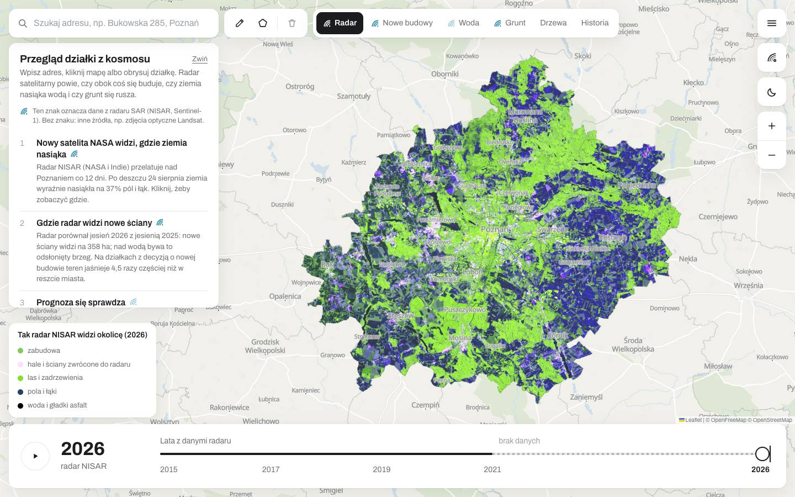

**02.** Karta miejsca w centrum, PL, laptop: prosty przegląd z dwiema grupami.

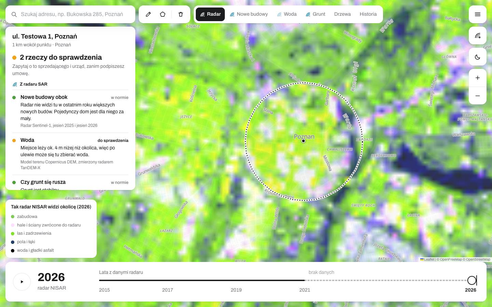

**03.** Ta sama karta na telefonie 390 px.

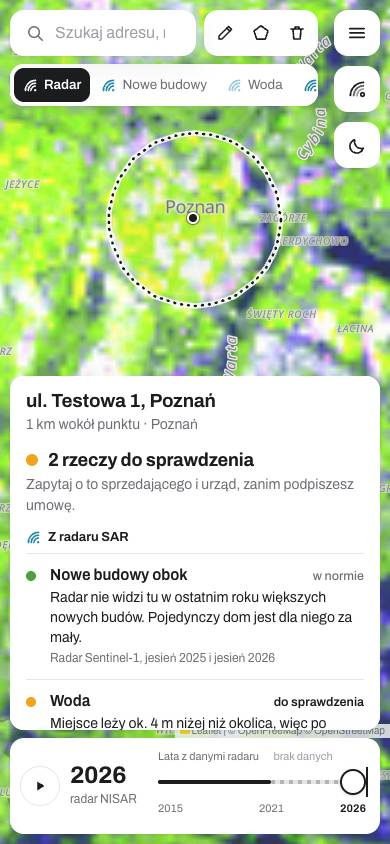

**04.** Karta przedmieścia po angielsku na telefonie 390 px.

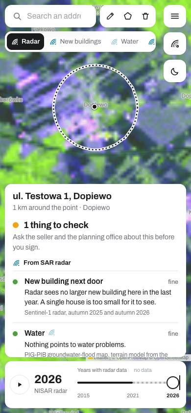

**05.** Warstwa ALOS-2 2018 z legendą.

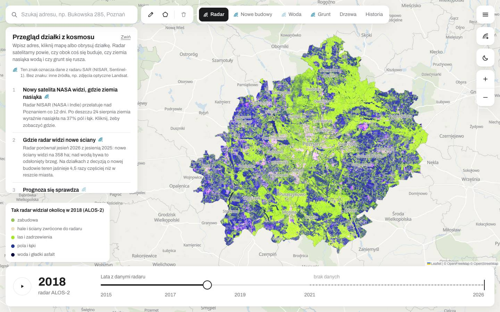

**06.** Otwarta szuflada; pasek widoków ukryty (poprawka A37).

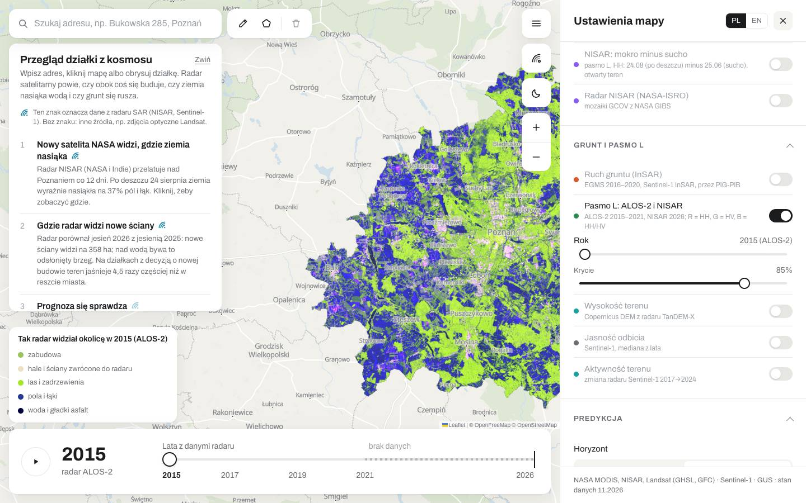

**07.** Arkusz „Jak widzi radar” na laptopie.

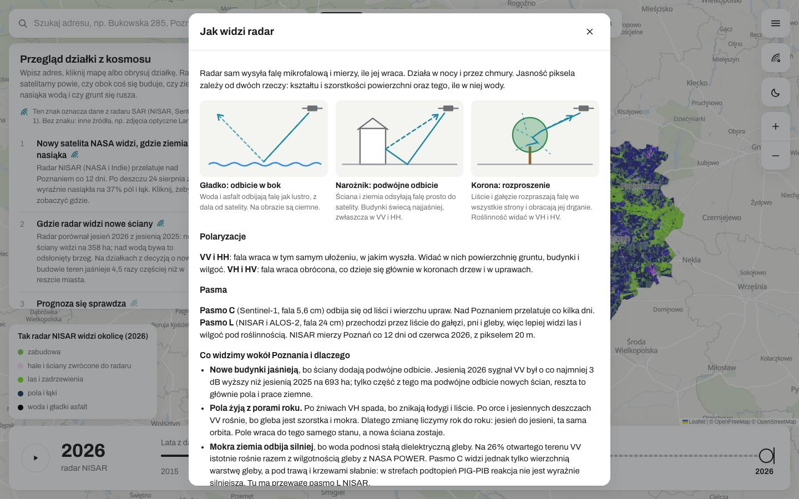

**08.** Arkusz „Jak widzi radar” na telefonie.

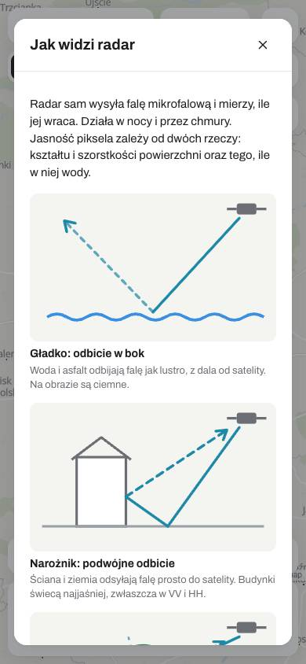

**09.** Narysowany wielokąt i karta obszaru.

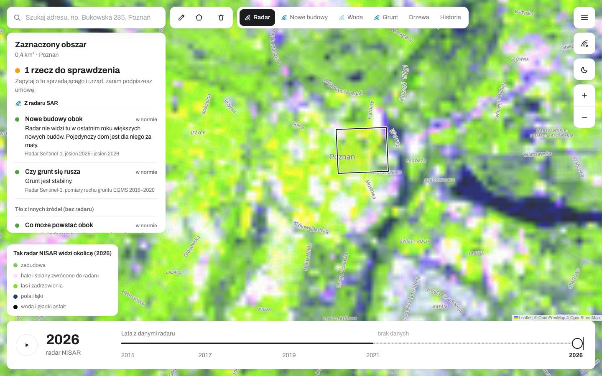

**10.** Karta w trybie ciemnym po angielsku.

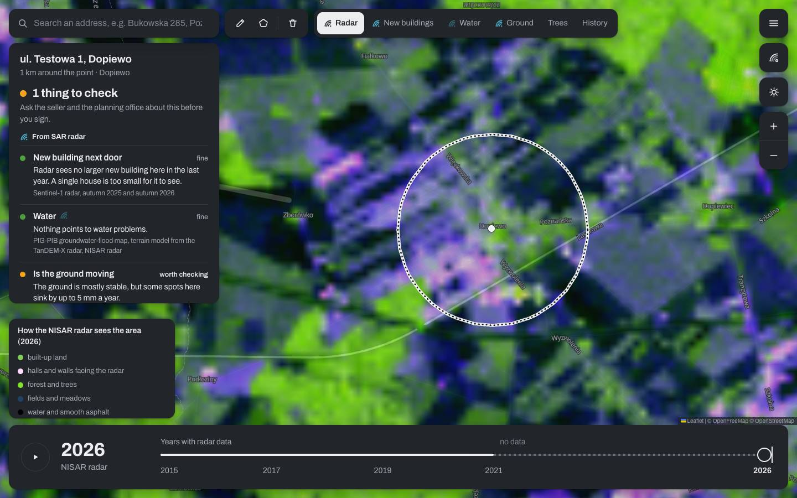

**11.** Dymek eksperta po polsku (po poprawkach A2 i A1).

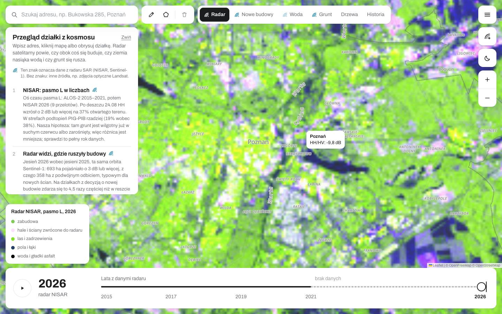

**12.** Wiersze przeglądu radarowego na karcie.

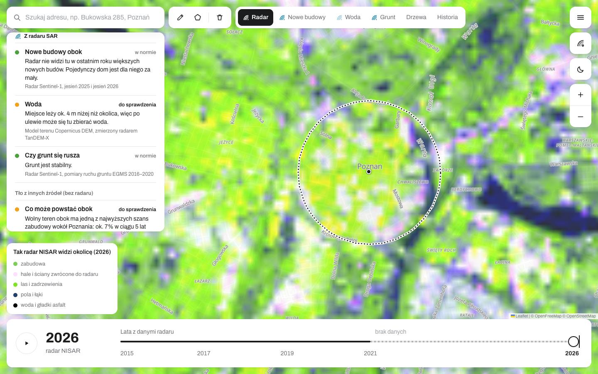

## Czego nie sprawdzono

- Niezweryfikowanych uwag: brak. Każda z 71 uwag przeszła drugą weryfikację.
- Nauka o radarze i potok danych: poza zakresem, w `NAUKA.md`. Dotyczy to rozciągnięcia kolorów NISAR (A55) i progów klas.
- Części dowodów nie powtórzono w weryfikacji: „12 z 12 miejsc” w A15 (zgodność reguły z tekstem sprawdzona w kodzie), czas 26 s na telefonie w A45, liczby kafli GIBS w A47, przypadek GIBS w A50, napis OpenFreeMap na mapie w A68 (sieć była zablokowana).
- Poprawki A47 nie zmierzono w przeglądarce, bo GIBS był zablokowany w testach poprawek.
- Poprawka A37 nie była oglądana ręcznie. Potwierdza ją tylko naprawiony test e2e i zrzut 04.
- Poprawki nie są wdrożone. Nie sprawdzono ich na żadnym adresie Firebase. Podglądy v2 i v3 są starsze od poprawek.
- Testy przeglądarkowe nie działają w GitHubie (potrzebują Chrome i sieci). Trzeba je uruchomić lokalnie przed przełączeniem wersji w niedzielę o 14:00.
- Tylko Chrome. Nie sprawdzono Safari (w tym iOS) ani Firefoksa.
- Telefon tylko w emulacji 390×844 z dotykiem. Bez prawdziwego urządzenia.
- Dostępność tylko częściowo: kontrast, fokus, nazwy suwaków. Bez czytnika ekranu.
- Zmiany autora w `app.js` po stanie `0cdedf1` nie są objęte przeglądem.
- Planowana przebudowa silnika mapy (`docs/poprawa_mapy.md`) i punkty z właścicielami (poza testami punktów 1 i 2) nie były sprawdzane.

## Odrzucone uwagi

Weryfikacja nie odrzuciła żadnej uwagi. Poprawiła za to kilka szczegółów. Nie zgłaszać ich ponownie w pierwotnej formie:

- A13 / A33 / A55: próbki legendy NISAR nie są identyczne (ΔE ok. 30–35). Problemem jest to, że legenda i mapa nie oddzielają zabudowy od lasu.
- A37: widoki zasłania szuflada (od x = 1000), a nie przyciski w prawym górnym rogu.
- A34: legenda przy włączonych decyzjach nie jest pusta w widoku radaru. Brakuje tylko bloku dla decyzji.
- A4: sprawdzona poprawka `bubblingMouseEvents: false` psuje rysowanie obszaru. Nie wdrażać jej bez obsługi `draw.mode`.
- A1 / A56: proste podmienienie `state.lang` na `lang` bez usunięcia słów pasma L dałoby po polsku „Teren zabudowany” nad lasem. Obie zmiany idą razem (tak jest w PR).
- A17 i A66: obniżone z ważnych do drobnych (karta podaje lata EGMS w źródle; nazwa jest w tytule karty przeglądarki). A1 jest ważna, nie blokerem (tylko tryb eksperta).
