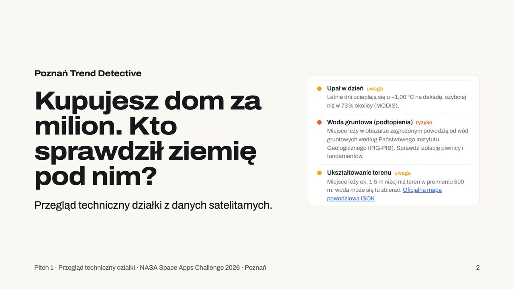
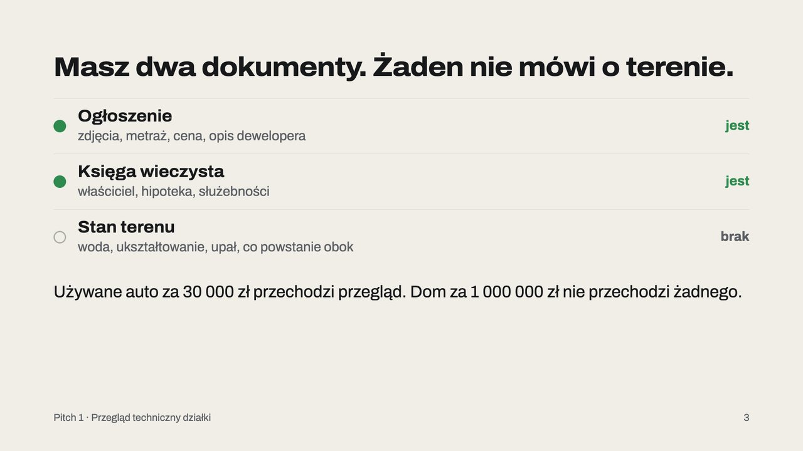
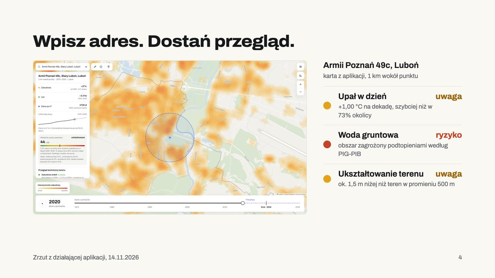
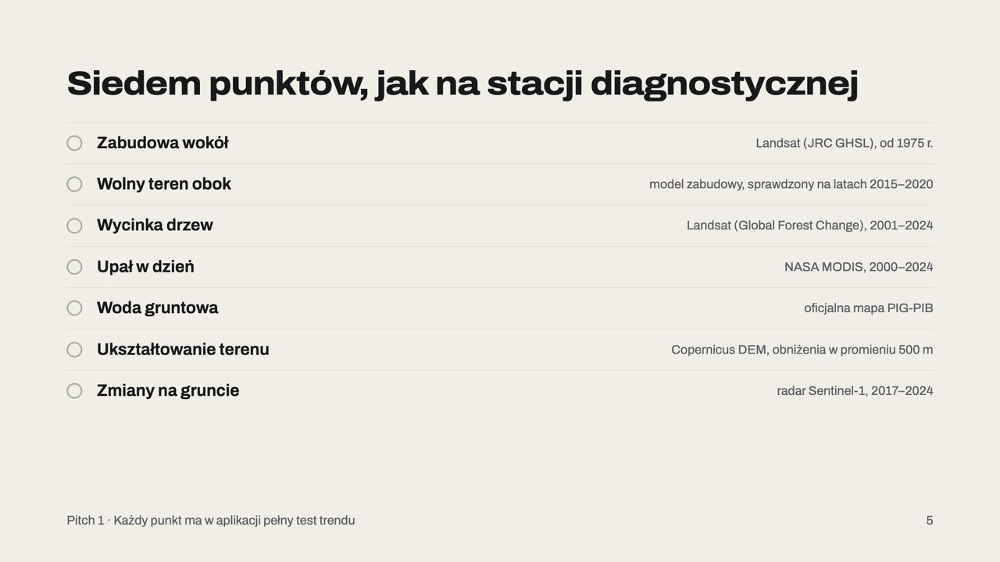
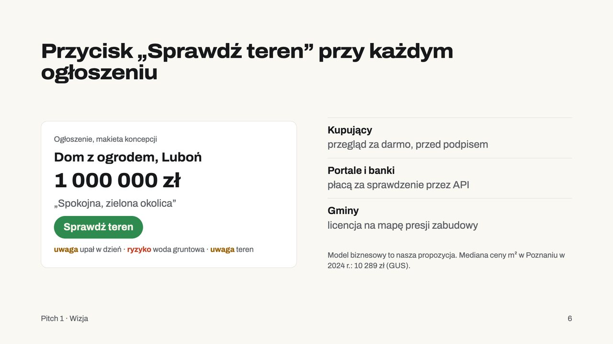
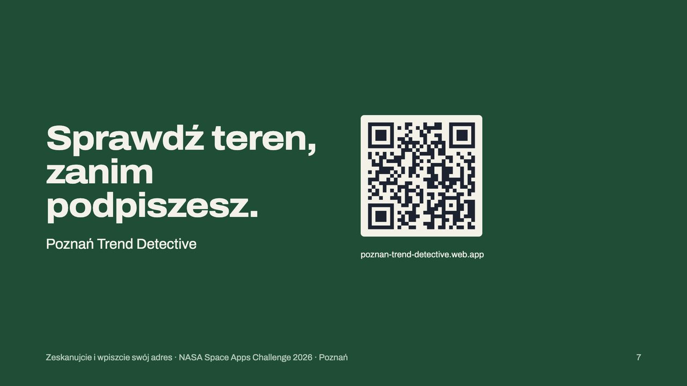

# Pitch 1: Przegląd techniczny działki

Gotowy pitch na żywo (ok. 3–4 min) dla Poznań Trend Detective, NASA Space Apps Challenge 2026, Poznań.
Slajdy: HTML w `slajdy/slides/a1.html`…`a6.html`, podgląd JPG w `podglad/`.

**Design:** Jasny, produktowy. Krój Archivo (szerokie nagłówki 760). Tło #FAF8F3 / #F0EEE7, tekst #17181A, kropki statusu jak w aplikacji: w normie #2F8A4F, uwaga #E3A21A (tekst #9A6200), ryzyko #C4442A. Slajd zamykający na zieleni #1F4D36.

Oznaczenie *(klik)* = element pojawia się po kliknięciu prelegenta.

---

## Slajd 1 (`a1`)



- Poznań Trend Detective
### Kupujesz dom za milion. Kto sprawdził ziemię pod nim?
- Przegląd techniczny działki z danych satelitarnych.
- [obraz] Fragment karty z aplikacji: przegląd techniczny terenu z punktami Upał w dzień (uwaga), Woda gruntowa (ryzyko), Ukształtowanie terenu (uwaga)
- [stopka] Pitch 1 · Przegląd techniczny działki · NASA Space Apps Challenge 2026 · Poznań

**Scenariusz i notatki prelegenta:**

```text
PITCH 1: PRZEGLĄD TECHNICZNY DZIAŁKI (ok. 3:30). Sens: każdy ma prawo wiedzieć, co kupuje, zanim podpisze. Role: A mówi, B prowadzi demo na laptopie.

A (bez wstępu, do sali): „Kto z Państwa kupował używane auto? (podnieście ręce) A kto sprawdził lakier, ramę, wycieki? (ręce zostają w górze) A kto kupował dom albo działkę? (pauza) Co wtedy sprawdziliście?”
A (wskazuje slajd): „Kupujesz dom za milion. Kto sprawdził ziemię pod nim? Nikt. Więc zrobiliśmy przegląd techniczny działki z danych satelitarnych. To jest Poznań Trend Detective.”

Po prawej: prawdziwy fragment karty z aplikacji. Kwota „milion” jest poglądowa.
```

---

## Slajd 2 (`a2`)



### Masz dwa dokumenty. Żaden nie mówi o terenie.
- Ogłoszenie
- zdjęcia, metraż, cena, opis dewelopera
- jest
- Księga wieczysta
- właściciel, hipoteka, służebności
- jest
- Stan terenu *(klik)*
- woda, ukształtowanie, upał, co powstanie obok *(klik)*
- brak *(klik)*
- Używane auto za 30 000 zł przechodzi przegląd. Dom za 1 000 000 zł nie przechodzi żadnego. *(klik)*
- [stopka] Pitch 1 · Przegląd techniczny działki

**Scenariusz i notatki prelegenta:**

```text
PROBLEM (ok. 30 s). Dwa kliknięcia.

A: „Kupując dom, masz dwa dokumenty. Ogłoszenie: zdjęcia, metraż, opis dewelopera. Księgę wieczystą: kto jest właścicielem, czy jest hipoteka.”
(klik) A: „Ale stan terenu? Czy podchodzi woda, czy działka leży w niecce, czy robi się coraz goręcej, co powstanie obok? Na to nie ma żadnego dokumentu.”
(klik) A: „Używane auto za 30 tysięcy przechodzi przegląd. Dom za milion nie przechodzi żadnego.”

Kwoty są poglądowe (hak zespołu), to nie dane.
```

---

## Slajd 3 (`a3`)



### Wpisz adres. Dostań przegląd.
- [obraz] Aplikacja Poznań Trend Detective z kartą adresu Armii Poznań 49c w Luboniu: mapa zabudowy, okrąg 1 km i karta z wykresem, wskaźnikiem ryzyka zabudowy i przeglądem technicznym terenu
- Armii Poznań 49c, Luboń
- karta z aplikacji, 1 km wokół punktu
- Upał w dzień *(klik)*
- uwaga *(klik)*
- +1,00 °C na dekadę, szybciej niż w 73% okolicy *(klik)*
- Woda gruntowa *(klik)*
- ryzyko *(klik)*
- obszar zagrożony podtopieniami według PIG-PIB *(klik)*
- Ukształtowanie terenu *(klik)*
- uwaga *(klik)*
- ok. 1,5 m niżej niż teren w promieniu 500 m *(klik)*
- [stopka] Zrzut z działającej aplikacji, 14.11.2026

**Scenariusz i notatki prelegenta:**

```text
DEMO NA ŻYWO (ok. 50 s). B prowadzi aplikację na laptopie podłączonym do rzutnika; ten slajd jest zapasem.

B: „Wpisuję zwykły adres w Luboniu.” (Albo do jury: „Podajcie swój adres!” Działa dla Poznania i 17 gmin powiatu poznańskiego.)
B: „Karta pokazuje przegląd techniczny terenu, punkt po punkcie.”
(klik) „Upał w dzień: uwaga. Letnie dni ocieplają się tu o stopień na dekadę, szybciej niż w 73 procentach okolicy.”
(klik) „Woda gruntowa: ryzyko. Oficjalny obszar zagrożony podtopieniami według Państwowego Instytutu Geologicznego.”
(klik) „Ukształtowanie terenu: uwaga. Półtora metra niżej niż okolica. Woda może się tu zbierać.”
A: „Tego nie napisze żadne ogłoszenie.”

Uczciwie: aplikacja nie przewiduje powodzi; pokazuje oficjalną mapę PIG-PIB i obniżenia terenu z modelu wysokości. Plan B: brak internetu → zostańcie na tym slajdzie i klikajcie punkty. Rano raz wpiszcie adres w aplikacji, bo publiczna wyszukiwarka adresów czasem chwilowo blokuje.
```

---

## Slajd 4 (`a4`)



### Siedem punktów, jak na stacji diagnostycznej
- Zabudowa wokół
- Landsat (JRC GHSL), od 1975 r.
- Wolny teren obok
- model zabudowy, sprawdzony na latach 2015–2020
- Wycinka drzew
- Landsat (Global Forest Change), 2001–2024
- Upał w dzień
- NASA MODIS, 2000–2024
- Woda gruntowa
- oficjalna mapa PIG-PIB
- Ukształtowanie terenu
- Copernicus DEM, obniżenia w promieniu 500 m
- Zmiany na gruncie
- radar Sentinel-1, 2017–2024
- [stopka] Pitch 1 · Każdy punkt ma w aplikacji pełny test trendu

**Scenariusz i notatki prelegenta:**

```text
JAK TO DZIAŁA (ok. 30 s).

A: „Przegląd ma siedem punktów, jak na stacji diagnostycznej. Zabudowa wokół od 1975 roku z Landsata. Szansa, że wolny teren obok zostanie zabudowany, z naszego modelu. Wycinka drzew. Upał w dzień z satelity NASA MODIS. Oficjalna mapa podtopień. Ukształtowanie terenu z modelu wysokości. I zmiany na gruncie z radaru.”
A: „Każdy punkt to otwarte dane i jeden przycisk, który pokazuje pełny test trendu.”

Na pytania: każdy trend liczymy testem Manna-Kendalla i nachyleniem Theila-Sena; kolor tylko przy p poniżej 0,05. Satelita nad Ławicą zgadza się z termometrem IMGW: r = 0,893 (24 lata).
```

---

## Slajd 5 (`a5`)



### Przycisk „Sprawdź teren” przy każdym ogłoszeniu
- Ogłoszenie, makieta koncepcji
- Dom z ogrodem, Luboń
- 1 000 000 zł
- „Spokojna, zielona okolica”
- Sprawdź teren
- uwaga upał w dzień · ryzyko woda gruntowa · uwaga teren
- Kupujący *(klik)*
- przegląd za darmo, przed podpisem *(klik)*
- Portale i banki *(klik)*
- płacą za sprawdzenie przez API *(klik)*
- Gminy *(klik)*
- licencja na mapę presji zabudowy *(klik)*
- Model biznesowy to nasza propozycja. Mediana ceny m² w Poznaniu w 2024 r.: 10 289 zł (GUS). *(klik)*
- [stopka] Pitch 1 · Wizja

**Scenariusz i notatki prelegenta:**

```text
WIZJA (ok. 40 s). Jedno kliknięcie odsłania model biznesowy.

A: „Wyobraźcie sobie ogłoszenie. Dom z ogrodem, milion złotych, «spokojna, zielona okolica». A obok jeden przycisk: Sprawdź teren. Klik i przed podpisem wiesz to, czego nie napisał sprzedający.”
(klik) A: „Dla kupującego za darmo. Płacą portale z ogłoszeniami i banki, które dają kredyt pod tę ziemię: za każde sprawdzenie przez API. A gminy dostają mapę, gdzie miasto będzie rosło.”
A: „Przy cenie ponad 10 tysięcy złotych za metr w Poznaniu przegląd terenu to drobny koszt.”

Uwaga: ogłoszenie to makieta, integracji z portalami jeszcze nie ma. Cena: mediana ceny m² w Poznaniu, 2024, GUS (land.json, prices).
```

---

## Slajd 6 (`a6`)



### Sprawdź teren, zanim podpiszesz.
- Poznań Trend Detective
- [obraz] Kod QR do aplikacji poznan-trend-detective.web.app
- poznan-trend-detective.web.app
- [stopka] Zeskanujcie i wpiszcie swój adres · NASA Space Apps Challenge 2026 · Poznań

**Scenariusz i notatki prelegenta:**

```text
ZAMKNIĘCIE (ok. 15 s).

A: „Przegląd auta robimy od lat. Przegląd ziemi, pod którą kładziemy oszczędności życia, od dziś. Zeskanujcie kod i wpiszcie swój adres. Poznań Trend Detective: sprawdź teren, zanim podpiszesz.”

PYTANIA JURY (przygotujcie):
• Skąd dane? Otwarte: NASA MODIS, Landsat (GHSL, GFC), NISAR, Sentinel-1, Copernicus DEM, PIG-PIB, GUS, IMGW. Skrypty liczą wszystko od zera w 40–60 minut.
• Czy przewidujecie powodzie? Nie. Pokazujemy oficjalną mapę PIG-PIB, obniżenia terenu i link do mapy ISOK.
• Jak dobry jest model? Na latach 2015–2020, których nie widział: 56,4% trafień; AUC na wolnym terenie 0,986 (prosta reguła 0,901). To ranking, nie wyrok.
• Czy to działa poza Poznaniem? Dane satelitarne są globalne; lokalne warstwy (PIG-PIB, GUS) trzeba podmienić.
```
