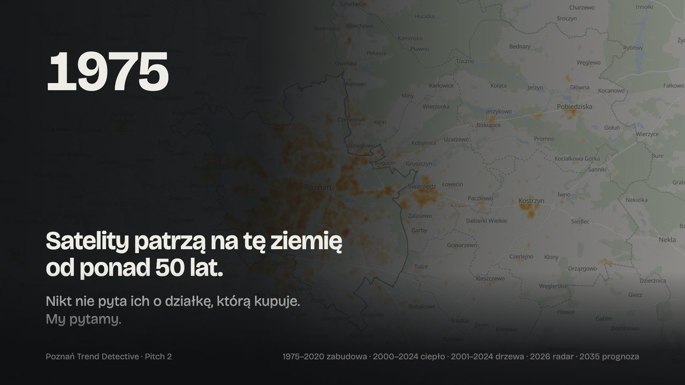
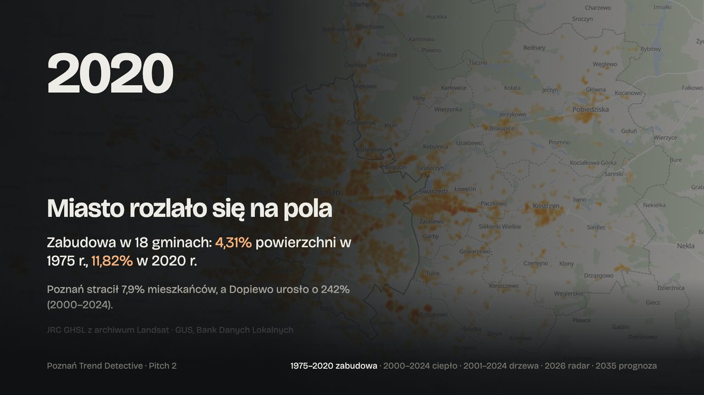
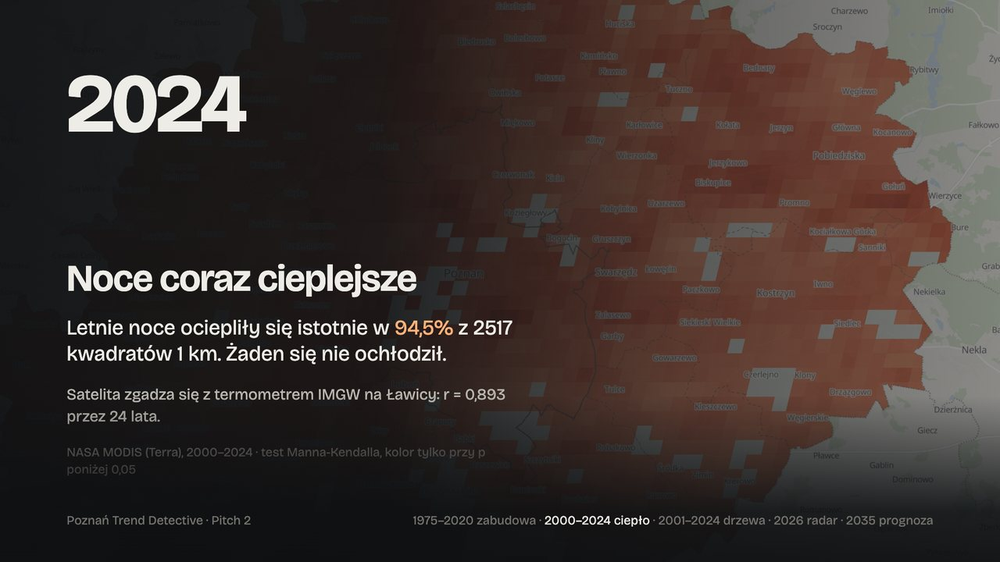
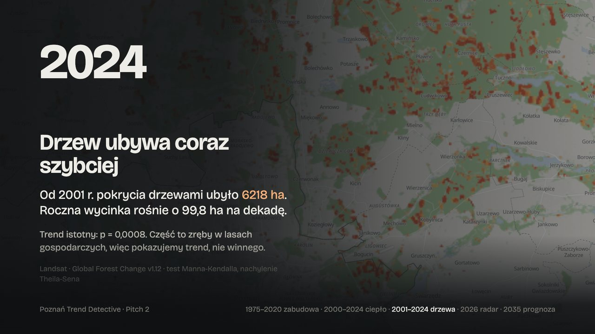
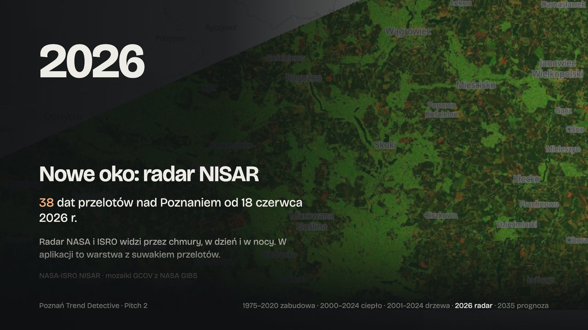
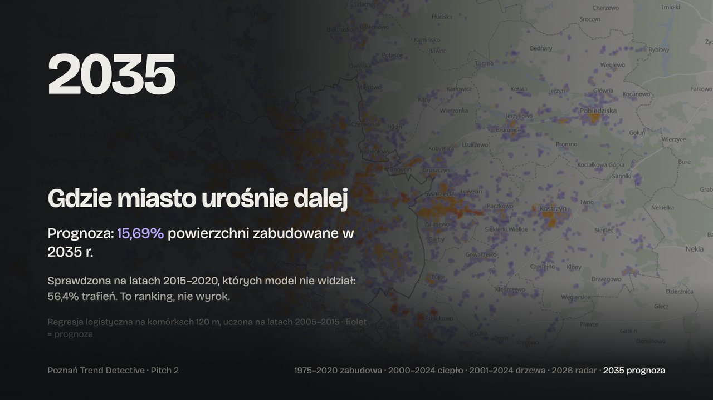
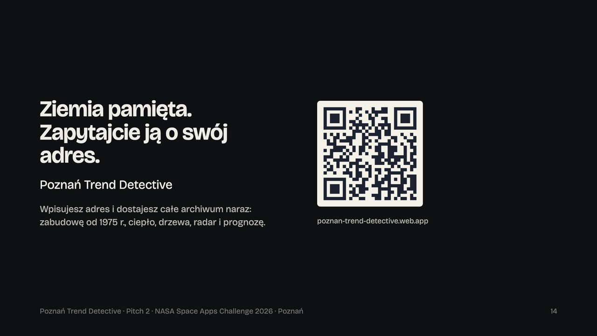

# Pitch 2: Ziemia pamięta

Gotowy pitch na żywo (ok. 3–4 min) dla Poznań Trend Detective, NASA Space Apps Challenge 2026, Poznań.
Slajdy: HTML w `slajdy/slides/b1.html`…`b7.html`, podgląd JPG w `podglad/`.

**Design:** Ciemny, kinowy. Krój Bricolage Grotesque. Pełnoekranowe warstwy z aplikacji przyciemnione (brightness 0.6) i cień od lewej i od dołu, tło #0E1012, tekst #EEECE6. Wielki rok (160 px) jako motyw, na dole linia rozdziałów z podświetlonym okresem. Kolor tylko w danych: zabudowa/ciepło #FFB27A, prognoza #B7A6FF.

Oznaczenie *(klik)* = element pojawia się po kliknięciu prelegenta.

---

## Slajd 1 (`b1`)



- [obraz] Mapa zabudowy Poznania i okolic w 1975 roku: niewielkie pomarańczowe skupiska w mieście
- 1975
### Satelity patrzą na tę ziemię od ponad 50 lat.
- Nikt nie pyta ich o działkę, którą kupuje. My pytamy.
- [stopka] Poznań Trend Detective · Pitch 2
- [stopka] 1975–2020 zabudowa · 2000–2024 ciepło · 2001–2024 drzewa · 2026 radar · 2035 prognoza

**Scenariusz i notatki prelegenta:**

```text
PITCH 2: ZIEMIA PAMIĘTA (ok. 3:30). Sens: satelity od dekad zapisują każdy kawałek ziemi; my zamieniamy to archiwum w odpowiedź dla jednego adresu, a każdy trend sprawdzamy testem. Najmocniejszy dla jury z NASA. Role: A narrator, B demo na końcu.

A (spokojnie, wolno): „To jest Poznań w 1975 roku, tak jak zapisał go satelita. Od ponad pięćdziesięciu lat satelity patrzą na każdy metr tej ziemi. Zapisały, gdzie stanęły domy, gdzie zniknął las, jak nagrzewają się noce.”
A: „A kiedy ktoś kupuje działkę, nikt ich nie pyta. My pytamy. Przejdźmy przez to archiwum rok po roku.”

Mapa: zabudowa w 1975 r. (JRC GHSL z archiwum Landsat). Landsat obserwuje Ziemię od 1972 r., stąd „ponad 50 lat”.
```

---

## Slajd 2 (`b2`)



- [obraz] Ta sama mapa w 2020 roku: pomarańczowa zabudowa rozlana daleko poza granice Poznania
- 2020
### Miasto rozlało się na pola
- Zabudowa w 18 gminach: 4,31% powierzchni w 1975 r., 11,82% w 2020 r.
- Poznań stracił 7,9% mieszkańców, a Dopiewo urosło o 242% (2000–2024). *(klik)*
- JRC GHSL z archiwum Landsat · GUS, Bank Danych Lokalnych
- [stopka] Poznań Trend Detective · Pitch 2
- [stopka] 1975–2020 zabudowa · 2000–2024 ciepło · 2001–2024 drzewa · 2026 radar · 2035 prognoza

**Scenariusz i notatki prelegenta:**

```text
ZABUDOWA (ok. 30 s).

A: „Rok 2020. W osiemnastu gminach wokół Poznania zabudowa zajmowała w 1975 roku 4,31 procent powierzchni. W 2020 już 11,82. Miasto rozlało się na pola.”
(klik) A: „I to nie dlatego, że Poznań urósł. Poznań stracił prawie 8 procent mieszkańców, a Dopiewo urosło o 242 procent. Ludzie wyprowadzają się za miasto, na działki, które kupują bez żadnego przeglądu.”

Źródła: land.json study_built_share_pct (1975 = 4,31; 2020 = 11,82); study.json areas pop_change_pct_2000_2024 (Poznań −7,9; Dopiewo +242,0).
```

---

## Slajd 3 (`b3`)



- [obraz] Mapa trendu letnich nocy z NASA MODIS: prawie wszystkie kwadraty 1 km w ciepłych kolorach, nieliczne szare, żadnego niebieskiego
- 2024
### Noce coraz cieplejsze
- Letnie noce ociepliły się istotnie w 94,5% z 2517 kwadratów 1 km. Żaden się nie ochłodził.
- Satelita zgadza się z termometrem IMGW na Ławicy: r = 0,893 przez 24 lata. *(klik)*
- NASA MODIS (Terra), 2000–2024 · test Manna-Kendalla, kolor tylko przy p poniżej 0,05
- [stopka] Poznań Trend Detective · Pitch 2
- [stopka] 1975–2020 zabudowa · 2000–2024 ciepło · 2001–2024 drzewa · 2026 radar · 2035 prognoza

**Scenariusz i notatki prelegenta:**

```text
CIEPŁO (ok. 30 s).

A: „Od 2000 roku satelita NASA MODIS mierzy temperaturę powierzchni każdego kwadratu kilometr na kilometr. Letnie noce ociepliły się istotnie w 94,5 procent kwadratów. Żaden się nie ochłodził.”
A: „Kolor na tej mapie znaczy: test statystyczny to potwierdził. Szary znaczy: brak dowodu.”
(klik) A: „I nie wierzymy satelicie na słowo: nad Ławicą zgadza się z termometrem IMGW, korelacja 0,893 przez 24 lata.”

Na pytania: temperatura powierzchni to dachy i grunt, nie powietrze; brak danych MODIS za 2025 r. Źródła: study.json pixel_summary (94,5; 0,0; 2517), ground.modis_vs_station.night_vs_tmin (r = 0,893, n = 24).
```

---

## Slajd 4 (`b4`)



- [obraz] Mapa lasów na północ od Poznania: zielone pokrycie drzewami i czerwone plamy wycinki z lat 2001–2024
- 2024
### Drzew ubywa coraz szybciej
- Od 2001 r. pokrycia drzewami ubyło 6218 ha. Roczna wycinka rośnie o 99,8 ha na dekadę.
- Trend istotny: p = 0,0008. Część to zręby w lasach gospodarczych, więc pokazujemy trend, nie winnego. *(klik)*
- Landsat · Global Forest Change v1.12 · test Manna-Kendalla, nachylenie Theila-Sena
- [stopka] Poznań Trend Detective · Pitch 2
- [stopka] 1975–2020 zabudowa · 2000–2024 ciepło · 2001–2024 drzewa · 2026 radar · 2035 prognoza

**Scenariusz i notatki prelegenta:**

```text
DRZEWA (ok. 25 s).

A: „Landsat zapisał też każdą wycinkę. Od 2001 roku w tych gminach pokrycia drzewami ubyło 6218 hektarów, a roczna wycinka rośnie o prawie sto hektarów na dekadę.”
(klik) A: „Test mówi, że to nie przypadek: p równe 0,0008. Uczciwie: część to zręby w lasach gospodarczych. Pokazujemy trend, nie szukamy winnego.”

Źródła: suma land.json municipalities forest_loss_total_ha = 6218; forest_loss_trend +99,8 ha/dekadę, p = 0,0008. Najwięcej ubyło w gminach leśnych (Murowana Goślina, Kórnik, Mosina), więc nie mówcie, że wszystko poszło pod zabudowę.
```

---

## Slajd 5 (`b5`)



- [obraz] Mozaika radarowa NISAR na północ od Poznania: zielono-brązowy obraz pól i lasów z ukośną krawędzią pasa przelotu
- 2026
### Nowe oko: radar NISAR
- 38 dat przelotów nad Poznaniem od 18 czerwca 2026 r.
- Radar NASA i ISRO widzi przez chmury, w dzień i w nocy. W aplikacji to warstwa z suwakiem przelotów. *(klik)*
- NASA-ISRO NISAR · mozaiki GCOV z NASA GIBS
- [stopka] Poznań Trend Detective · Pitch 2
- [stopka] 1975–2020 zabudowa · 2000–2024 ciepło · 2001–2024 drzewa · 2026 radar · 2035 prognoza

**Scenariusz i notatki prelegenta:**

```text
RADAR (ok. 25 s).

A: „A w tym roku archiwum dostało nowe oko. NISAR, radar NASA i indyjskiej agencji ISRO. Od 18 czerwca przeleciał nad Poznaniem w 38 dniach. Widzi przez chmury, w dzień i w nocy. W aplikacji przewijacie te przeloty suwakiem.”
(klik, krótko) A: „To znaczy, że od teraz zmiany na gruncie zobaczymy co kilkanaście dni, nie co rok.”

Źródło: land.json nisar_dates (38 dat, pierwsza 2026-06-18). Na pytania: przy zbliżeniu niektóre kafle GIBS mieszają produkty; najczyściej wygląda pas z 28.10.2026.
```

---

## Slajd 6 (`b6`)



- [obraz] Mapa na 2035 rok: pomarańczowa zabudowa i fioletowe komórki prognozy modelu rozlane wokół Poznania
- 2035
### Gdzie miasto urośnie dalej
- Prognoza: 15,69% powierzchni zabudowane w 2035 r.
- Sprawdzona na latach 2015–2020, których model nie widział: 56,4% trafień. To ranking, nie wyrok. *(klik)*
- Regresja logistyczna na komórkach 120 m, uczona na latach 2005–2015 · fiolet = prognoza
- [stopka] Poznań Trend Detective · Pitch 2
- [stopka] 1975–2020 zabudowa · 2000–2024 ciepło · 2001–2024 drzewa · 2026 radar · 2035 prognoza

**Scenariusz i notatki prelegenta:**

```text
PROGNOZA (ok. 30 s).

A: „Archiwum mówi też, co będzie dalej. Nasz model pokazuje, gdzie miasto urośnie do 2035 roku: fioletowe komórki. Zabudowa sięgnie 15,69 procent powierzchni.”
(klik) A: „Sprawdziliśmy go uczciwie. Uczył się na latach 2005–2015, a test zrobiliśmy na latach 2015–2020, których nie widział. Trafił w 56,4 procent. Dlatego mówimy: to ranking, nie wyrok.”

Na pytania: AUC na wolnym terenie 0,986, prosta reguła sąsiedztwa 0,901. Na samym wolnym terenie top-N 1,3% (76 przypadków): model wskaże okolicę, nie konkretną działkę. Nie zna planów miejscowych ani nowych dróg.
```

---

## Slajd 7 (`b7`)



### Ziemia pamięta. Zapytajcie ją o swój adres.
- Poznań Trend Detective
- Wpisujesz adres i dostajesz całe archiwum naraz: zabudowę od 1975 r., ciepło, drzewa, radar i prognozę.
- [obraz] Kod QR do aplikacji poznan-trend-detective.web.app
- poznan-trend-detective.web.app
- [stopka] Poznań Trend Detective · Pitch 2 · NASA Space Apps Challenge 2026 · Poznań

**Scenariusz i notatki prelegenta:**

```text
DEMO I ZAMKNIĘCIE (ok. 40 s).

B przełącza na aplikację i wpisuje adres (Armii Poznań 49c w Luboniu albo adres od jury). B: „Jeden adres i całe archiwum naraz: zabudowa od 1975 roku, ciepło, drzewa, radar, prognoza. I przegląd techniczny terenu: upał uwaga, woda gruntowa ryzyko, teren uwaga.”
A (wraca do slajdu): „Satelity patrzą na tę ziemię od ponad pięćdziesięciu lat. Ziemia pamięta. Zapytajcie ją o swój adres. Poznań Trend Detective.”

PYTANIA JURY:
• Dlaczego Mann-Kendall? Nie zakłada rozkładu normalnego i dobrze działa na krótkich szeregach; nachylenie Theila-Sena jest odporne na pojedyncze skrajne lata. Wyniki sprawdziliśmy z SciPy.
• Rozdzielczość? MODIS 1 km (ciepło), 250 m (zieleń); Landsat 30 m; komórki modelu 120 m.
• Co z 2025? Brak danych MODIS za 2025 w naszym pobraniu (study.json, missing_years), więc szereg kończy się na 2024.
• Odtwarzalność: skrypty liczą wszystko od zera w 40–60 minut z otwartych danych.
```
