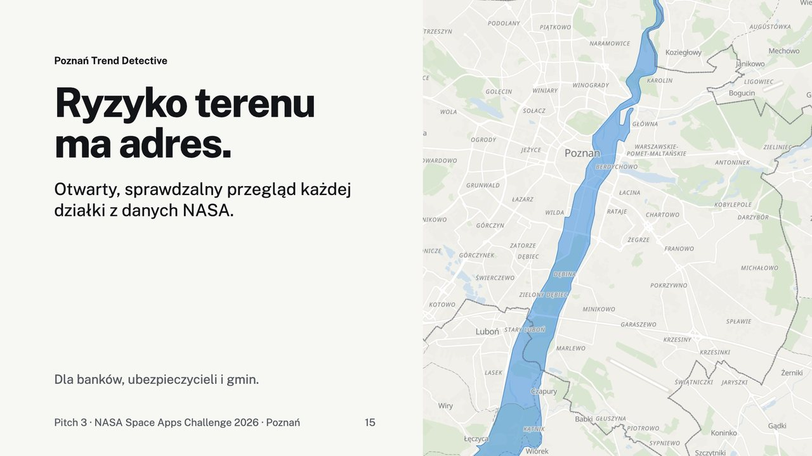
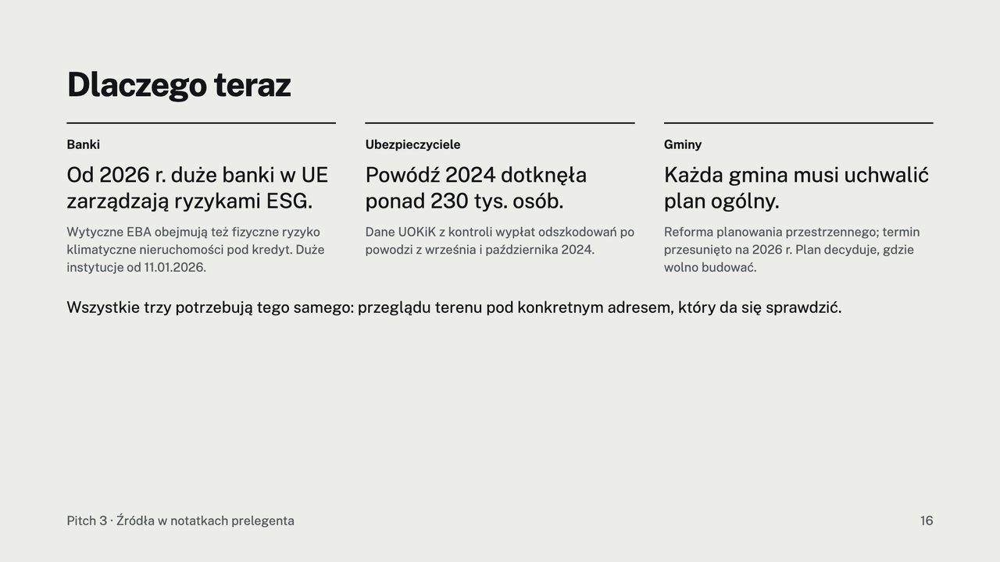
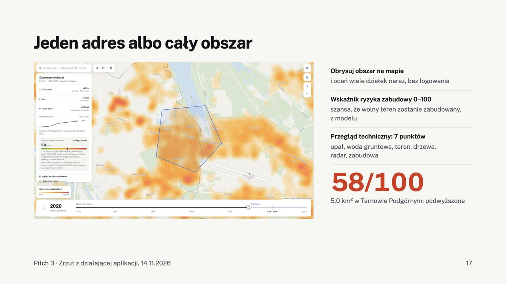
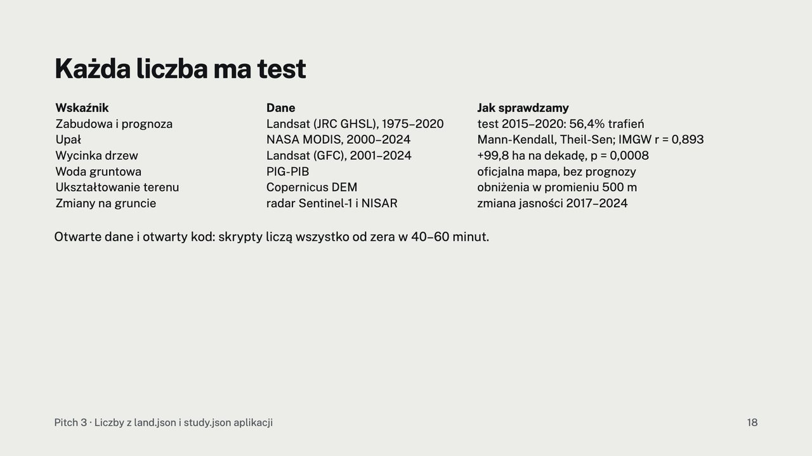
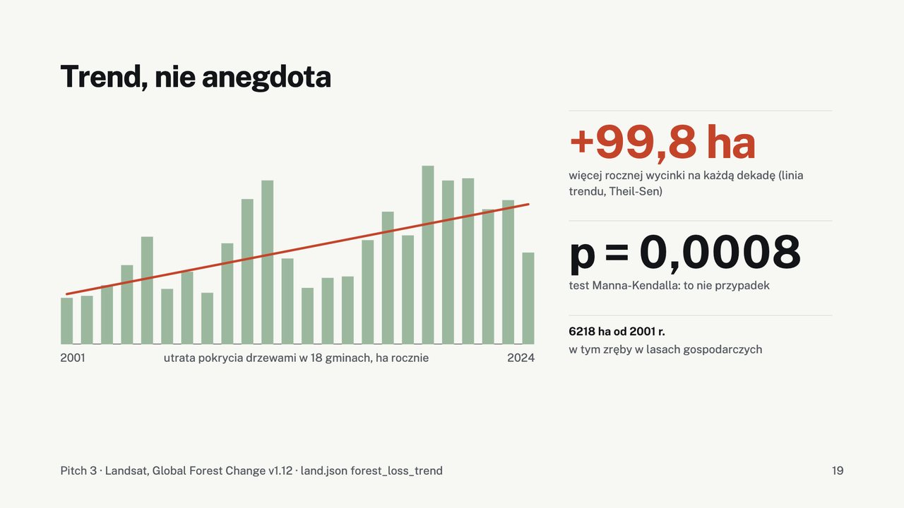
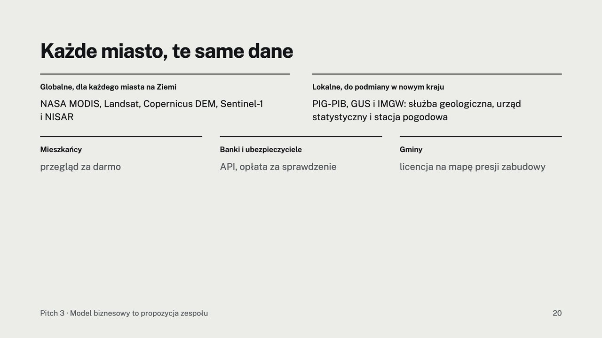
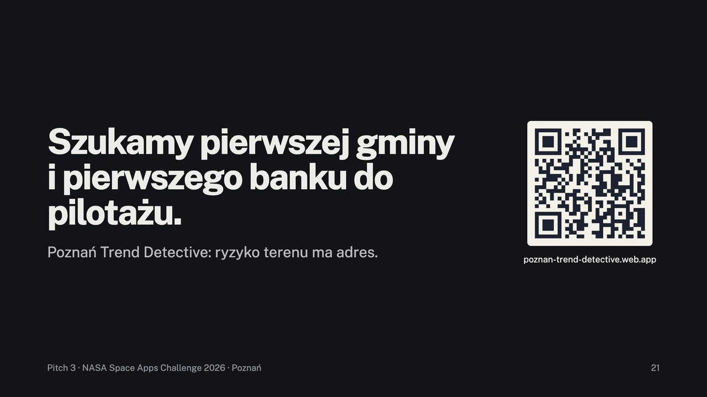

# Pitch 3: Ryzyko terenu ma adres

Gotowy pitch na żywo (ok. 3–4 min) dla Poznań Trend Detective, NASA Space Apps Challenge 2026, Poznań.
Slajdy: HTML w `slajdy/slides/c1.html`…`c7.html`, podgląd JPG w `podglad/`.

**Design:** Raport w stylu szwajcarskim. Krój Public Sans. Tło #F7F7F4 / #ECEDE8, tekst #121417, cienkie linie #D3D4CE, kolumny z grubą linią nad nagłówkiem, tabela, prawdziwy wykres SVG (wycinka drzew, linia Theila-Sena). Kolor tylko w danych: ryzyko #C4442A. Slajd zamykający na #121417.

Oznaczenie *(klik)* = element pojawia się po kliknięciu prelegenta.

---

## Slajd 1 (`c1`)



- [obraz] Mapa aplikacji z warstwą obszarów zagrożonych podtopieniami PIG-PIB: niebieski pas doliny Warty przez Poznań i Luboń
- Poznań Trend Detective
### Ryzyko terenu ma adres.
- Otwarty, sprawdzalny przegląd każdej działki z danych NASA.
- Dla banków, ubezpieczycieli i gmin.
- [stopka] Pitch 3 · NASA Space Apps Challenge 2026 · Poznań

**Scenariusz i notatki prelegenta:**

```text
PITCH 3: RYZYKO TERENU MA ADRES (ok. 3:30). Sens: ryzyko terenu staje się pozycją w każdym kredycie, polisie i planie gminy; dziś liczy się je drogo i w zamkniętych modelach. My dajemy otwarty, sprawdzalny przegląd z globalnych danych NASA. Role: A mówi, B demo.

A (spokojnie, rzeczowo): „Na mapie obok: niebieski pas to oficjalny obszar zagrożony podtopieniami wzdłuż Warty, przez Poznań i Luboń. Każdy dom w tym pasie ma kredyt, polisę i gminę, która decyduje, co obok wolno zbudować. Każda z tych trzech stron musi dziś policzyć ryzyko tego terenu.”
A: „Ryzyko terenu ma adres. My dajemy do niego otwarty, sprawdzalny przegląd z danych NASA.”

Mapa: warstwa PIG-PIB w aplikacji (obszary zagrożone podtopieniami od wód gruntowych).
```

---

## Slajd 2 (`c2`)



### Dlaczego teraz
- Banki
- Od 2026 r. duże banki w UE zarządzają ryzykami ESG.
- Wytyczne EBA obejmują też fizyczne ryzyko klimatyczne nieruchomości pod kredyt. Duże instytucje od 11.01.2026.
- Ubezpieczyciele
- Powódź 2024 dotknęła ponad 230 tys. osób.
- Dane UOKiK z kontroli wypłat odszkodowań po powodzi z września i października 2024.
- Gminy
- Każda gmina musi uchwalić plan ogólny.
- Reforma planowania przestrzennego; termin przesunięto na 2026 r. Plan decyduje, gdzie wolno budować.
- Wszystkie trzy potrzebują tego samego: przeglądu terenu pod konkretnym adresem, który da się sprawdzić. *(klik)*
- [stopka] Pitch 3 · Źródła w notatkach prelegenta

**Scenariusz i notatki prelegenta:**

```text
DLACZEGO TERAZ (ok. 40 s).

A: „Dlaczego teraz? Trzy powody. Banki: od 2026 roku duże banki w Unii muszą zarządzać ryzykami ESG, także fizycznym ryzykiem klimatycznym nieruchomości, pod które dają kredyt. Ubezpieczyciele: powódź 2024 dotknęła ponad 230 tysięcy osób. Gminy: każda musi uchwalić plan ogólny, który decyduje, gdzie wolno budować.”
(klik) A: „Wszyscy trzej potrzebują tego samego: przeglądu terenu pod konkretnym adresem. Takiego, który da się sprawdzić.”

ŹRÓDŁA (sprawdźcie rano, przepisy się zmieniają):
• EBA, wytyczne o zarządzaniu ryzykami ESG: duże instytucje od 11.01.2026, małe od 11.01.2027 (grantthornton.co.uk/insights/eba-issues-final-guidelines-on-managing-esg-risks; regulationtomorrow.com, styczeń 2025).
• UOKiK o odszkodowaniach po powodzi 2024: szkody dotknęły ponad 230 tys. osób (wartowiedziec.pl, „Odszkodowania po powodzi. Prezes UOKiK sprawdził ubezpieczycieli”).
• Plany ogólne: termin przesunięty z 31.12.2025 na 2026 r., zależny od KPO (blog.ongeo.pl, kilka artykułów 2025–2026). Nie podawajcie konkretnej daty bez sprawdzenia w Dzienniku Ustaw.
```

---

## Slajd 3 (`c3`)



### Jeden adres albo cały obszar
- [obraz] Aplikacja z obszarem obrysowanym na mapie w Tarnowie Podgórnym i kartą: 5,0 km², wskaźnik ryzyka zabudowy 58 na 100, podwyższone
- Obrysuj obszar na mapie
- i oceń wiele działek naraz, bez logowania
- Wskaźnik ryzyka zabudowy 0–100
- szansa, że wolny teren zostanie zabudowany, z modelu
- Przegląd techniczny: 7 punktów
- upał, woda gruntowa, teren, drzewa, radar, zabudowa
- 58/100 *(klik)*
- 5,0 km² w Tarnowie Podgórnym: podwyższone *(klik)*
- [stopka] Pitch 3 · Zrzut z działającej aplikacji, 14.11.2026

**Scenariusz i notatki prelegenta:**

```text
PRODUKT I DEMO (ok. 45 s). B prowadzi aplikację; slajd jest zapasem.

B: „Bank albo gmina nie sprawdza jednego adresu, tylko cały teren. Obrysowuję obszar na mapie, tu 5 kilometrów kwadratowych w Tarnowie Podgórnym.”
B: „Karta od razu: wskaźnik ryzyka zabudowy, czyli szansa, że wolny teren obok zostanie zabudowany. I przegląd techniczny w siedmiu punktach: upał, woda gruntowa, ukształtowanie terenu, drzewa, radar, zabudowa.”
(klik) B: „Tutaj 58 na 100: podwyższone. Bez logowania, bez czarnej skrzynki.”

Na pytania: wskaźnik to skala logarytmiczna 5-letniej szansy z modelu (0,1% = 0 pkt, 30% = 100 pkt); progi: niskie poniżej 0,5%, umiarkowane do 2%, podwyższone do 5%, wysokie do 15%, bardzo wysokie powyżej.
```

---

## Slajd 4 (`c4`)



### Każda liczba ma test
- Otwarte dane i otwarty kod: skrypty liczą wszystko od zera w 40–60 minut. *(klik)*
- [stopka] Pitch 3 · Liczby z land.json i study.json aplikacji

| Wskaźnik | Dane | Jak sprawdzamy |
|---|---|---|
| Zabudowa i prognoza | Landsat (JRC GHSL), 1975–2020 | test 2015–2020: 56,4% trafień |
| Upał | NASA MODIS, 2000–2024 | Mann-Kendall, Theil-Sen; IMGW r = 0,893 |
| Wycinka drzew | Landsat (GFC), 2001–2024 | +99,8 ha na dekadę, p = 0,0008 |
| Woda gruntowa | PIG-PIB | oficjalna mapa, bez prognozy |
| Ukształtowanie terenu | Copernicus DEM | obniżenia w promieniu 500 m |
| Zmiany na gruncie | radar Sentinel-1 i NISAR | zmiana jasności 2017–2024 |

**Scenariusz i notatki prelegenta:**

```text
RZETELNOŚĆ (ok. 35 s).

A: „Bank nie kupi czarnej skrzynki. Dlatego każda liczba ma test. Prognoza zabudowy sprawdzona na latach, których model nie widział: 56,4 procent trafień. Upał: test Manna-Kendalla i zgodność z termometrem IMGW, korelacja 0,893. Wycinka: trend istotny, p 0,0008. Woda gruntowa to oficjalna mapa, bez naszej prognozy.”
(klik) A: „Dane i kod są otwarte. Skrypty odtwarzają wszystko od zera w 40–60 minut. Każdy audytor może to sprawdzić.”

Na pytania: AUC na wolnym terenie 0,986 wobec 0,901 dla prostej reguły; ograniczenia: rozdzielczość 10–30 m, temperatura powierzchni, nie powietrza; ceny dla powiatów, nie adresów; prognoza w tempie z lat 2010–2020.
```

---

## Slajd 5 (`c5`)



### Trend, nie anegdota
- [obraz] Utrata pokrycia drzewami w 18 gminach, hektary rocznie, 2001–2024, słupki rosną, z czerwoną linią trendu Theila-Sena idącą w górę
- 2001
- utrata pokrycia drzewami w 18 gminach, ha rocznie
- 2024
- +99,8 ha
- więcej rocznej wycinki na każdą dekadę (linia trendu, Theil-Sen)
- p = 0,0008
- test Manna-Kendalla: to nie przypadek
- 6218 ha od 2001 r.
- w tym zręby w lasach gospodarczych
- [stopka] Pitch 3 · Landsat, Global Forest Change v1.12 · land.json forest_loss_trend

**Scenariusz i notatki prelegenta:**

```text
TREND (ok. 25 s).

A: „Tak wygląda pojedynczy trend w naszym przeglądzie. Słupki: ile pokrycia drzewami ubywało co roku w osiemnastu gminach. Czerwona linia: trend. Roczna wycinka rośnie o prawie sto hektarów na dekadę, a test mówi, że to nie przypadek: p równe 0,0008.”
A: „Tak samo liczymy ciepło i zabudowę. Dla każdego kwadratu. Dlatego wynik można obronić przed komitetem kredytowym albo radą gminy.”

Dane: land.json forest_loss_trend (lata 2001–2024, ha rocznie; nachylenie Theila-Sena +99,8 ha na dekadę, p = 0,0008), suma 6218 ha. Najwięcej ubyło w gminach leśnych.
```

---

## Slajd 6 (`c6`)



### Każde miasto, te same dane
- Globalne, dla każdego miasta na Ziemi
- NASA MODIS, Landsat, Copernicus DEM, Sentinel-1 i NISAR
- Lokalne, do podmiany w nowym kraju
- PIG-PIB, GUS i IMGW: służba geologiczna, urząd statystyczny i stacja pogodowa
- Mieszkańcy *(klik)*
- przegląd za darmo *(klik)*
- Banki i ubezpieczyciele *(klik)*
- API, opłata za sprawdzenie *(klik)*
- Gminy *(klik)*
- licencja na mapę presji zabudowy *(klik)*
- [stopka] Pitch 3 · Model biznesowy to propozycja zespołu

**Scenariusz i notatki prelegenta:**

```text
SKALA I MODEL (ok. 30 s).

A: „Zbudowaliśmy to dla Poznania, ale rdzeń jest globalny. MODIS, Landsat, Copernicus DEM, Sentinel-1 i NISAR pokrywają każde miasto na Ziemi. Lokalnie podmieniamy tylko trzy warstwy: mapę geologiczną, statystykę i stację pogodową.”
(klik) A: „Model: dla mieszkańców za darmo. Banki i ubezpieczyciele płacą za sprawdzenie przez API. Gminy kupują licencję na mapę presji zabudowy.”

Uczciwie: integracji z bankami jeszcze nie ma; to propozycja. Skrypty liczą dane dla Poznania od zera w 40–60 minut, więc nowe miasto to głównie podmiana warstw lokalnych.
```

---

## Slajd 7 (`c7`)



### Szukamy pierwszej gminy i pierwszego banku do pilotażu.
- Poznań Trend Detective: ryzyko terenu ma adres.
- [obraz] Kod QR do aplikacji poznan-trend-detective.web.app
- poznan-trend-detective.web.app
- [stopka] Pitch 3 · NASA Space Apps Challenge 2026 · Poznań

**Scenariusz i notatki prelegenta:**

```text
PROŚBA I ZAMKNIĘCIE (ok. 20 s).

A: „Mamy działające narzędzie, otwarte dane i testy, które każdy może powtórzyć. Szukamy pierwszej gminy i pierwszego banku do pilotażu tu, w Poznaniu. Zeskanujcie kod i sprawdźcie swój adres. Poznań Trend Detective: ryzyko terenu ma adres.”

PYTANIA JURY:
• Czym różnicie się od komercyjnych modeli ryzyka? Otwarte dane, otwarty kod, każdy test do powtórzenia; skala od adresu do obszaru.
• Czy przewidujecie powodzie? Nie. Pokazujemy oficjalną mapę PIG-PIB i obniżenia terenu, z linkiem do mapy ISOK.
• Jak dokładny jest model? 56,4% trafień na latach, których nie widział; AUC na wolnym terenie 0,986 wobec 0,901. Ranking, nie wyrok.
• Ograniczenia? Rozdzielczość 10–30 m; temperatura powierzchni, nie powietrza; ceny dla powiatów; prognoza w tempie z lat 2010–2020.
• Dane osobowe? Żadnych: tylko otwarte dane o terenie.
```
